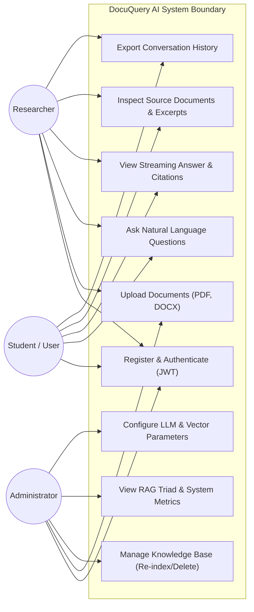
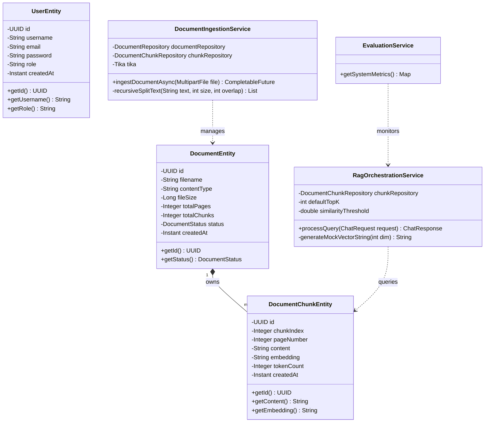
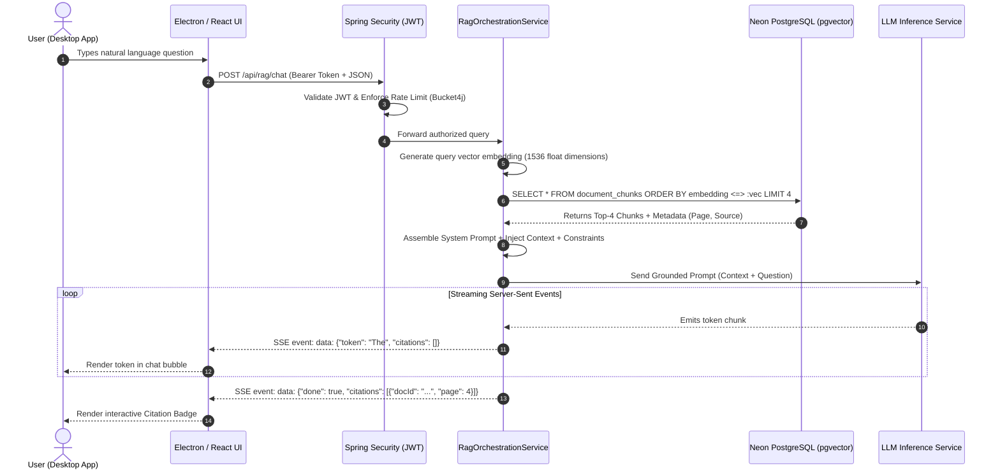
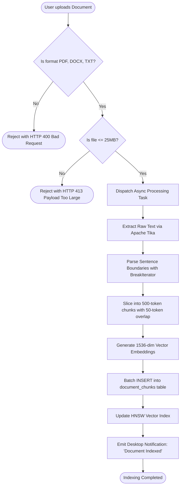
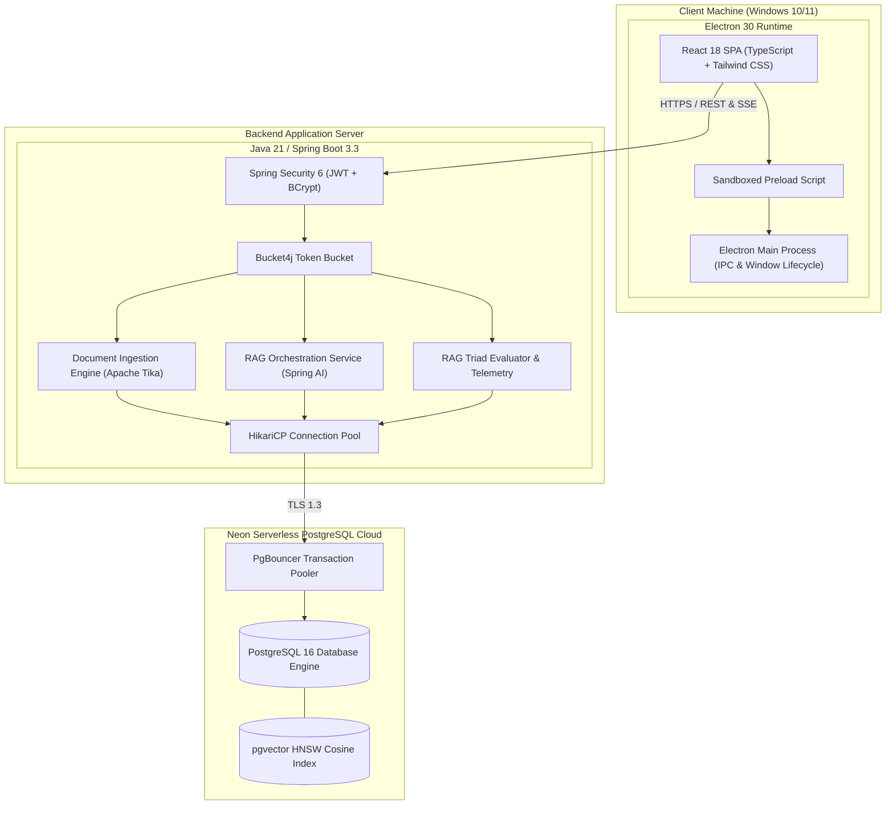
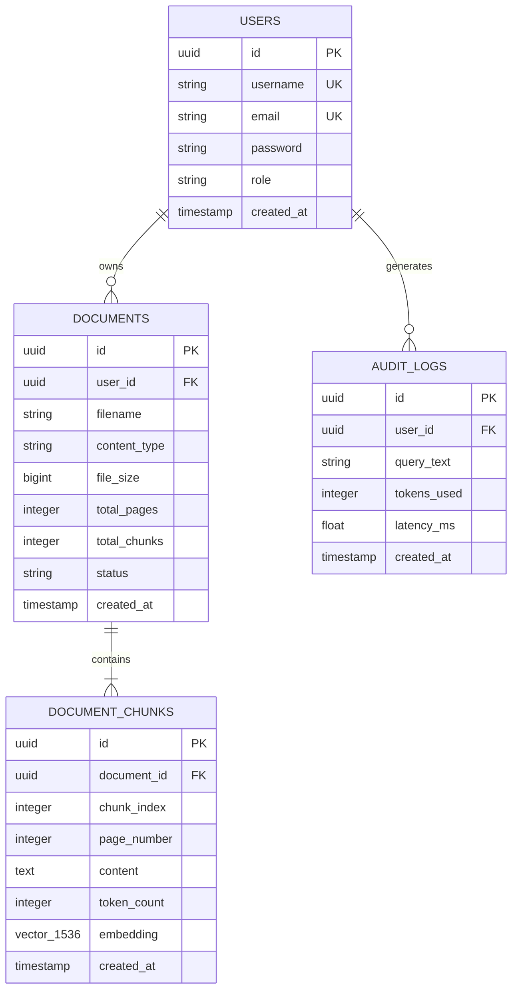

# UML DESIGN & MODELING PACKAGE
## DocuQuery AI: Enterprise Retrieval-Augmented Generation Platform

**Course:** Java Project Based Learning (PBL) — 5th Semester  
**Institution:** Arya College of Engineering & I.T., Jaipur (Dept. of AI&DS - Artificial Intelligence & Data Science)  
**Mentor:** Er. Ram Babu Buri  
**Team Members:** Shaurya Dixit, Yashvardhan Singh Chauhan, Vaibhav Tank, Rajveer Singh Ranawat, Yashpal Singh Bhati  
**Data Corpus:** Kaggle Academic Research Paper Corpus  

---

### TABLE OF CONTENTS
1. [Use Case Diagram & Actor Descriptions](#1-use-case-diagram)
2. [Class Diagram (Domain Models & Services)](#2-class-diagram)
3. [Sequence Diagram (End-to-End RAG Query Flow)](#3-sequence-diagram)
4. [Activity Diagram (Document Ingestion & Chunking Pipeline)](#4-activity-diagram)
5. [Component & Deployment Diagram](#5-component--deployment-diagram)
6. [Entity-Relationship (ER) Diagram (Neon PostgreSQL Database)](#6-entity-relationship-er-diagram)

---

### 1. USE CASE DIAGRAM

#### Actor Roles:
* **Student**: General user who authenticates, asks natural-language questions, inspects source citation badges, and downloads chat histories.
* **Researcher**: Contributor who uploads research papers, books, and curriculum notes into the shared workspace.
* **Administrator**: System administrator with privileges to monitor vector capacity, view RAG Triad telemetry, and purge documents.

---

### 2. CLASS DIAGRAM

---

### 3. SEQUENCE DIAGRAM (RAG Query Execution)

---

### 4. ACTIVITY DIAGRAM (Document Chunking Pipeline)

---

### 5. COMPONENT & DEPLOYMENT DIAGRAM

---

### 6. ENTITY-RELATIONSHIP (ER) DIAGRAM

